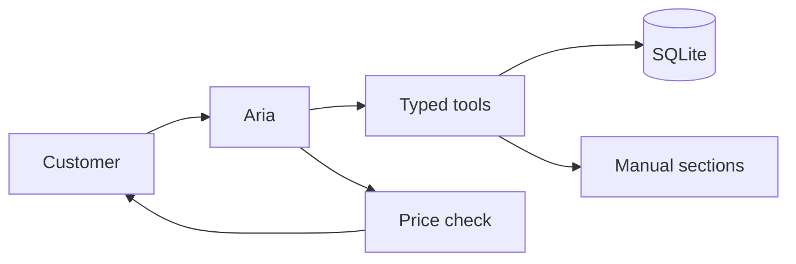
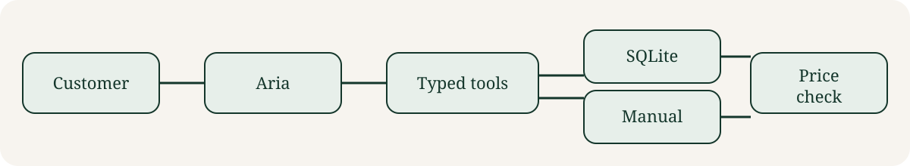

<p align="center">
  
</p>

<p align="center">
  <a href="https://www.python.org/downloads/release/python-3120/"></a>
  <a href="https://github.com/melocalex/music-store-ai-agent/actions/workflows/ci.yml"></a>
  <a href="LICENSE"></a>
  <a href="https://ai.pydantic.dev/"></a>
  <a href="https://ai.google.dev/"></a>
</p>

Aria is the virtual assistant for Empório da Música, a fictional instrument shop in Campo Grande, Mato Grosso do Sul. She answers from the catalog, the order book, and a short manual. A price that no tool returned does not reach the customer.

<p align="center">
  <a href="LIVE_DEMO_URL"><strong>Try it live, no API key needed</strong></a>
</p>

## 🧭 What is distinctive

Every data conflict below has a decision and an eval id. The measured table is regenerated from the CSVs into [`docs/data-quality.md`](docs/data-quality.md).

| Finding | Decision | Eval id |
| --- | --- | --- |
| 65 products, 9 categories, three empty families | Answer with the catalog count, not “300+” | empty-winds |
| One out of stock, two discontinued, one coming soon | Sell only active items with stock. Coming soon has no price | coming-soon |
| Brand clash in six descriptions | Drop the blurb. Keep name, price, and specs | unit |
| Customers 11 and 43 share an email | Email alone never identifies someone. Check the order | other-order |
| Orders 3 and 20 store a total other than the item sum | Report the stored total. Never recompute history | stored-total |
| PIX history is the list total, not list minus 5% | Do not rewrite old PIX orders | stored-total |
| No stored total includes the R$ 35 freight | Do not add freight back into history | freight-exact |
| Some old parcels sit under today’s floors | History is not a precedent | c40-installments |
| Saved delivery windows are 10–15 calendar days | A general question uses 1–3 business days. An order uses its saved date | late-order |
| Order 8 is still shipped after its estimate | Say the estimate passed. Offer a handoff | late-order |
| Some campaigns sit outside the manual’s percent bands | Only an active promotion changes the price | expired-promo |
| Black Friday has three rows and zero active | Answer from `is_active` | black-friday |
| GD20’s 12% offer is inactive | Quote the current price and PIX. Do not emit the old percent | gd20-code |

A reply is a message plus a list of `(product_id, amount)` quotes. Every amount in the message, digits or words, has to be one of those quotes. A quote with a product id has to be a value a tool returned for that product. A policy figure may use a null product id only when it is not also some product’s price.

No live Gemini count is stored in this repo. The tests reject a price tied to the wrong product, a price no tool returned, and a price written in words. A live run writes both numbers, firings and true catches, to `evals/results/`.

The hosted page pins the store clock, shows sample questions, and lists the tool calls for the turn with email and phone masked. A visitor does not paste a key. The host does. The app sleeps on Community Cloud after inactivity and wakes on the next visit.

### Known failures

No live score is checked in. Fill the table from `evals/results/` after a real run.

| Situation | What you will see |
| --- | --- |
| The customer types a budget such as R$ 1000 | The reply can be blocked, because that number is not a tool price |
| The price check fails twice | A short fallback with no amount, plus a local handoff |
| The host key is missing | The page says the host has not configured the key |
| The provider returns 429 | A one-line “try again in a minute” message |

## ▶️ Run it in 3 steps

You need Python 3.12, [uv](https://docs.astral.sh/uv/) or pip, and a Gemini key for a local model call. The hosted demo does not ask the visitor for one.

```bash
uv venv && uv pip install -e ".[dev]"
export GOOGLE_API_KEY="your-key"
export MODEL="google-gla:gemini-3.5-flash"
python -m music_store_agent
# or: streamlit run app.py
```

`MODEL` can be `google-gla:gemini-3.8-flash` or a flash-lite id. The app does not set a low temperature.

## 💬 Try asking

- Quais violões até R$ 1000 vocês têm?
- Quanto custa o Takamine?
- O Takamine GD-20 da Black Friday ainda tem desconto?
- Qual o preço do Crafter HT-100 no PIX?
- Vocês abrem no sábado e no dia 13 de junho?
- Qual o frete do Yamaha C40 para São Paulo?
- Me arrependi de uma compra. Posso devolver?
- Quero saber o status de um pedido.

## 🔧 How it works





| Tool | What it answers | Guardrail |
| --- | --- | --- |
| `search_catalog` | Sellable items, five at a time | Active and in stock. Effective price at or under the cap |
| `get_product` | One model code, or a list when several match | Exact code. Coming soon has no price |
| `quote_offer` | PIX, card, installments, freight | One calculator. No freight number outside Campo Grande |
| `list_active_promotions` | Campaigns that are active now | Inactive rows are names, not prices |
| `consult_policy` | Whole manual sections | No search index. The section list is the boundary |
| `verify_customer` | That this order belongs to this contact | Full email or full phone. Three tries, then a handoff |
| `get_order` | Status, stored total, tracking | Only orders of the confirmed customer |
| `explain_after_sales` | 30-day exchange and 90-day warranty | States both, asks for the receipt date, does not approve |
| `check_hours` | Open, closed, next opening, holidays | Fixed holiday list. The next opening skips those days |
| `handoff_to_human` | A note for the team | The only write. No email or phone in the file |

## 🛡️ Guardrails

| Rule | What Aria does |
| --- | --- |
| Sellable | `active` and stock above zero. Discontinued stock stays unsold |
| Money | Named constants. R$ 100 is only the 7–12x parcel floor. Exactly R$ 500 ships free in the city. Exactly R$ 2000 cannot split PIX and card |
| PIX | 5% on the list price only. Never on top of an active promo |
| Identity | Order id plus the full email or full phone of that order. Last digits are not enough |
| History | Stored totals, estimates, and old parcels are reported, not corrected |
| Scope | A rule can be explained. A purchase, cancel, address change, return, or out-of-city freight is handed off |
| Output | One retry, then a fallback with no amount |
| Caps | 30 turns in a session, 80 turns on the real Campo Grande date |

## ✅ Quality

```bash
ruff check .
pytest
python -m evals.run --runs 3 --model google-gla:gemini-3.5-flash
python -m examples.generate
```

Offline, `pytest` never calls a provider. `python -m evals.run --stub` runs the same checks against a local script. The stub pass rate is not a live score.

## 📐 Design decisions

| Choice | Why |
| --- | --- |
| One agent, ten tools | The manual is short. A second agent would only move the same rules |
| SQLite at startup | The CSVs are the dataset. An audit runs from the same load |
| Whole policy sections | About 1,070 words. Section lookup is deterministic |
| Pinned clock | The CSVs are a frozen snapshot. A real November 2026 clock expires every window. The demo stays pinned to 23 Mar 2026, the day after the last order |
| Quotes on the reply | The string check and the structured rows run in the same validator |

| Model | When |
| --- | --- |
| `google-gla:gemini-3.5-flash` | Default |
| `google-gla:gemini-3.8-flash` | Set `MODEL` when you want the newer flash |
| a flash-lite id | Set `MODEL` when you want the cheaper tier |

## ⚠️ Known limitations

| Where | Conflict | What the agent does |
| --- | --- | --- |
| Manual vs catalog | “300+ instruments”; three families are empty | Says 65 products, and that the empty families have nothing for sale |
| Phones | The cover lists one number as phone and WhatsApp | WhatsApp is (67) 3321-4500. (67) 3341-4444 is the landline |
| Email | The manual also shows an accented spelling | Uses `contato@emporiodamusica.com.br` |
| Installments | A one-line “minimum R$ 100” sits above the tier table | R$ 100 applies only to 7–12x. 4–6x uses R$ 80. Under R$ 50 there is no plan |
| Freight vs split | Both texts say “above” | Freight is free from R$ 500 inclusive. Split payment starts strictly above R$ 2000 |
| Warranty | 30 days from purchase, 90 days from receipt | States both. The receipt date is not in the data, so the team confirms |
| Delivery | Policy says 1–3 business days. Saved estimates are 10–15 calendar days | A general answer uses the policy. A specific order uses the saved date |
| Hours source | A layout extract can scramble a PDF. On this file the hours rows were intact, and later sections broke across pages | The agent reads the curated manual, not the PDF |
| Holidays | Carnival, Good Friday, and Corpus Christi move | They are not in the list. The tool says so |
| Descriptions | Six blurbs name a different brand, by a word-boundary rule | Those blurbs are omitted |
| Coming soon | Product 130 was already on two orders | It is not sold, and the old orders are not rewritten |
| Provider | A free Gemini tier may use prompts to improve the service | Do not type real customer data. This is a prototype on fictional rows |
| Rate limit | The provider can return 429 | The customer sees a short retry message, not a stack trace |

## 🗂️ What’s inside

```text
app.py                     hosted chat
music_store_agent/         agent, tools, calculator, manual
data/                      fictional CSVs
docs/data-quality.md       generated findings
evals/scenarios.yaml       25 scenarios
examples/                  transcript generator
tests/                     offline pytest
```

## 🚫 What I deliberately left out

| Left out | Why | When I would add it |
| --- | --- | --- |
| RAG, vectors, BM25 | The manual is about 1,070 words and is read in whole sections | When the docs no longer fit a section lookup |
| LangGraph or several agents | One assistant already has the whole job | When a second job needs its own state |
| MCP | The tools are plain typed functions | After an auth redesign. See below |
| Write actions | Cancel, address change, and creating a return commit the store | When there is a real order service to call |
| Real customer auth | The check is the order id plus the full contact on that order | When accounts exist |
| Fine-tuning | The failures here are data and policy, not phrasing | When the rules are stable and the misses are linguistic |
| Chat history beyond the session | A transcript is personal data, even in a demo | When there is a retention decision and a place to store it |

With more time I would expose the tools through MCP. They are plain typed functions today, and that needs an auth redesign first.

## 🏗️ How this was built

The design was reviewed before the code. Implementation followed that review. Each file then went through a smell-gate audit, and the money and policy calls stayed human decisions.

Before finalizing the design, I reviewed several public approaches to similar store-assistant datasets to make sure the data-quality findings and guardrails go beyond the common baseline; no code was reused.

TODO(author): replace this paragraph with your own note about the workflow.

## 📄 License

MIT. Copyright (c) 2026 Alexandre Melo.
