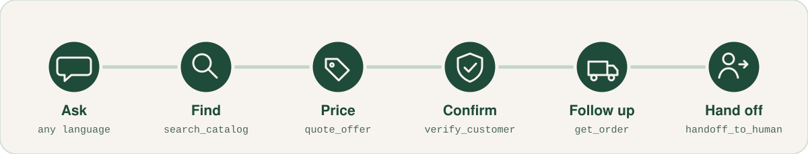
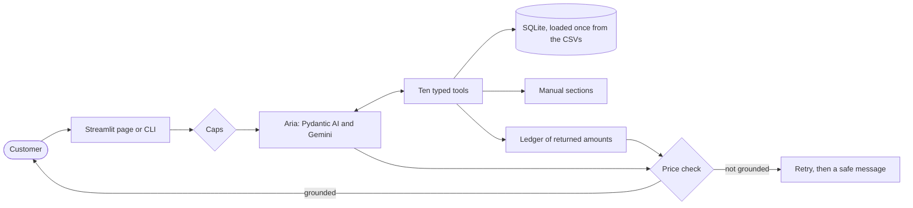

<p align="center"></p>
<p align="center">
  <b>Ask about an instrument, a price, an order, or a store rule. Aria answers from the catalog, the order book, and the policy manual, and a price no tool returned never reaches the customer.</b><br>
  <a href="LIVE_DEMO_URL"><b>Live demo</b></a> · <a href="docs/setup.md">Setup</a> · <a href="docs/architecture.md">Architecture</a> · <a href="docs/guardrails.md">Guardrails</a> · <a href="docs/data-quality.md">Data quality</a> · <a href="docs/evals.md">Evals</a>
</p>
<p align="center">
  <a href="https://www.python.org/downloads/release/python-3120/"></a>
  <a href="https://github.com/melocalex/music-store-ai-agent/actions/workflows/ci.yml"></a>
  <a href="https://ai.pydantic.dev/"></a>
  <a href="https://ai.google.dev/"></a>
  <a href="https://docs.astral.sh/ruff/"></a>
  <a href="LICENSE"></a>
</p>

> [!NOTE]
> **Live demo:** the link above points to `LIVE_DEMO_URL`, a placeholder until the hosted app is deployed. The hosted demo keeps the model key on the server, so visitors only type their question. The store, catalog, customers, and orders are fictional.

## 🚀 Run it in 3 steps

| Step | You need | You get |
|:-:|---|---|
| **1** | git | the code, the store CSVs, and the policy PDF |
| **2** | Python 3.12 | the app, the CLI, and the test tools |
| **3** | nothing else | lint, 104 tests, and 28 scenarios through the real tools, all offline |

```bash
# 1. Clone
git clone https://github.com/melocalex/music-store-ai-agent.git && cd music-store-ai-agent

# 2. Install
python3.12 -m venv .venv && source .venv/bin/activate && pip install -e ".[dev]"

# 3. Check it offline
ruff check . && pytest && python -m evals.run --stub --runs 1
```

Saw `Pass rate: 28/28`? Then talk to Aria in the terminal or in the Streamlit page: [docs/setup.md](docs/setup.md) shows both.

> [!IMPORTANT]
> The stub run scripts the model's turns and runs them through the real tools and the real price check. It tests the code, not Gemini. A live score is reported only after a live run.

<p align="center"></p>

## 🧭 The customer journey

| # | The customer asks | Aria | Tool |
|:-:|---|---|---|
| **1** | "Quais violões até R$ 1000?" | lists what is for sale under the budget, five at a time | `search_catalog` |
| **2** | "Quanto custa o GD-20?" | price, PIX, specs, and any active promotion with its original price and percent | `get_product` |
| **3** | "E em 6x? E o frete?" | installments, PIX, and city freight from one calculator | `quote_offer` |
| **4** | "A Black Friday está valendo?" | only the promotions that are active today | `list_active_promotions` |
| **5** | "Posso devolver?" | the rule, read from the manual section | `consult_policy` |
| **6** | "Pedido 4, e-mail lucas…" | confirms the order with the full email or phone | `verify_customer` |
| **7** | "Cadê meu pedido?" | status, stored total, items, tracking, and a late estimate | `get_order` |
| **8** | "A garantia ainda vale?" | the exchange and warranty windows, never an approval | `explain_after_sales` |
| **9** | "Vocês abrem sábado?" | the hours of that day, holidays, and whether it is open now | `check_hours` |
| **10** | "Quero falar com alguém" | records the case and says when the team replies | `handoff_to_human` |

## 🧩 Examples

Five scripted conversations are defined in [`examples/generate.py`](examples/generate.py). `python -m examples.generate` plays them against the live model and writes one transcript per script, with the model, the reference date, and the commit id in its header.

| Script | What the conversation covers |
|---|---|
| `violao-budget` | a budget search, an electroacoustic follow-up, and 10x refused with the allowed maximum |
| `gd20-black-friday` | an ended campaign named as ended, then the current price and PIX |
| `regret` | a wrong email, the right one, the receipt date, and a handoff |
| `address-and-scope` | an address change handed off, Saturday hours, strings, an off-topic question, a discount request |
| `warranty-tension` | order 7 on day 48: exchange closed, legal warranty open, complaint recorded |

> [!NOTE]
> Pending: no transcript is in the repository yet. They need a live model run, and they will land in `examples/transcripts/` when that run happens.

## ✨ Highlights

- **Prices are checked, not trusted.** Every amount in a reply, in any form (`R$ 1.749,00`, `1,749.00`, `99,98`, or "mil e duzentos reais"), must match a value a tool returned for the product named in that sentence. Percents too. Otherwise the model retries, then the customer gets a short message with no amount.
- **The data is audited.** A generated report lists each conflict in the CSVs, the decision taken, and the scenario that covers it.
- **The clock is pinned** to the day after the last order, Monday 23 March 2026, so exchange windows and late orders read the way the data was recorded.
- **Identity is order-scoped.** An order opens with its own full email or phone, never with a guess, and three failures close the session.
- **One agent, ten typed tools.** The manual is short enough to read by section, so there is no search index.

## 🛡️ Guardrails

| Area | Rule |
|---|---|
| Sale | Only active items with stock are sold. Coming soon, discontinued, and out of stock carry no price |
| Money | Named constants and `Decimal`. PIX is 5% off the list price and never on top of a promotion |
| Installments | Floors of R$ 50, 80, and 100 per parcel by tier, on the exact parcel. Leftover cents go in the first one |
| Orders | The full email or phone of that order. A shared email needs the phone. Three attempts per session |
| Scope | A rule can be explained. A purchase, cancellation, address change, or return is handed to the team |

Every rule, with its source and the conflicts in the manual: [docs/guardrails.md](docs/guardrails.md).

## 📊 Data quality

- 65 products, 61 for sale, and three families with nothing in them, against a manual that claims "300+".
- Two orders store a total other than their item sum, and every PIX order stores the list total. History is reported, never recomputed.
- Customers 11 and 43 share one email, so an email alone cannot open their orders.
- Two promotions sit outside their own campaign band, and three old parcels sit under today's floors.

The full table is generated from the CSVs: [docs/data-quality.md](docs/data-quality.md).

## 🧪 Evals

28 scenarios in [`evals/scenarios.yaml`](evals/scenarios.yaml) check facts: which tool ran with which key arguments, what the tool text holds, which amounts the reply carries or avoids, and a few short keywords. The same checks score the stub and a live run. Live reports are committed to `evals/results/`. Flags, metrics, and the scenario format: [docs/evals.md](docs/evals.md).

## 🔧 How it works



Tools, turn flow, and modules: [docs/architecture.md](docs/architecture.md).

## 📦 What's inside

```text
music-store-ai-agent/
├── app.py                  the hosted chat page
├── music_store_agent/      agent, tools, calculator, guard, clock, and the curated manual
├── data/                   the store CSVs and the policy PDF
├── evals/                  28 scenarios, the scorer, and live results
├── examples/               the transcript generator and its transcripts
├── docs/                   setup, architecture, guardrails, data quality, evals
└── tests/                  offline pytest, no provider call
```

## 🎯 Scope

| Left out | Why | When it would come in |
|---|---|---|
| RAG, vectors, BM25 | The manual is about 1,400 words and is read in whole sections | When the documents no longer fit a section lookup |
| Several agents or a graph | One assistant already holds the whole job | When a second job needs its own state |
| MCP | The tools are plain typed functions behind a session identity | After an auth redesign |
| Write actions | A cancellation, an address change, or a return commits the store | When there is an order service to call |
| Customer accounts | An order is opened by its own email or phone | When accounts exist |
| Fine-tuning | The hard cases are data and policy, not phrasing | When the rules are stable and the misses are linguistic |
| Chat history across sessions | A transcript is personal data, even in a demo | When there is a retention policy and a place to keep it |

## ⚠️ Known failures

| Situation | What happens |
|---|---|
| A reply puts a price in a sentence that names a different product | The check rejects it. After two retries the customer gets a short message and the team gets a handoff |
| A product is named only by brand, as in "o Takamine" | The sentence check cannot tie the amount to a model, so it relies on the quote's product id |
| A percent written in words, as in "cinco por cento" | The percent check reads digits only |
| Carnival, Good Friday, or Corpus Christi | Moving holidays are not in the list. Aria says so and hands off |
| Freight to another city | Not calculated. The team quotes it |
| The provider quota runs out | A short message names the limit. The daily cap is 80 turns |
| A live eval score | None is committed yet |

## 🗺️ Roadmap

- Commit the first live eval report and the five transcripts.
- Read the receipt date from the carrier, so the 7- and 90-day windows no longer need the customer.
- Quote freight for other cities through a carrier API.
- Load moving holidays from a calendar source.
- Expose the tools over MCP once the session identity is redesigned.
- Add write actions behind an order service, each with its own confirmation step.

## 🏗️ How this was built

The design came first, as a written spec of tools, guardrails, and data decisions. The code followed in small commits, each gated by `ruff check .`, `pytest`, and the scenario run. Every money, policy, and identity rule lives in `music_store_agent/constants.py` and is pinned by a test.

Before settling the design, I reviewed public approaches to this same store dataset to compare data-quality findings and guardrails. No code was reused.

Built with Cursor and Claude Code as development tools.

## 📚 Documentation

| Page | Covers |
|---|---|
| [Setup](docs/setup.md) | local install, model key and model id, the CLI and the page, hosting, caps and rate limits |
| [Architecture](docs/architecture.md) | the ten tools, the turn flow, the ledger, the clock, and the modules |
| [Guardrails](docs/guardrails.md) | every rule, its source, and the conflicts in the manual |
| [Data quality](docs/data-quality.md) | the report generated from the CSVs |
| [Evals](docs/evals.md) | how to run them, the flags, the scenario format, and the metrics |

## 📄 License

MIT. Copyright (c) 2026 Alexandre Melo.

---
[Setup →](docs/setup.md)

<p align="center"></p>
