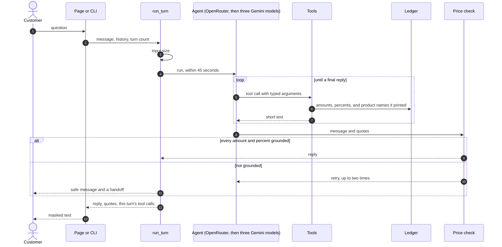

# Architecture

One Pydantic AI agent on Claude Haiku through OpenRouter, with three Gemini models behind it, ten typed tools, an in-memory SQLite copy of the CSVs, the curated manual, and a price check on every reply.

## Turn flow

`run_turn` in `music_store_agent/run.py` owns the failures. A provider error the chain did not absorb, every model failing, or a turn past 45 seconds becomes a fixed message. A turn in which the price check fired and the model never recovered becomes the safe price message and a `price_check` handoff. Any other agent failure becomes a short "please rephrase" message with no handoff.

## Models

`build_agent` in `agent.py` runs the live agent on a Pydantic AI `FallbackModel`:

| Role | Variable | Default |
|---|---|---|
| First, when `OPENROUTER_API_KEY` is set | `OPENROUTER_MODEL` | `anthropic/claude-haiku-5.5` |
| Primary | `MODEL` | `google:gemini-3.8-flash` |
| Fallback | `MODEL_FALLBACK` | `google:gemini-3.6-flash` |
| Reserve | `MODEL_RESERVE` | `google:gemini-3.5-flash-lite` |

Each model in the chain is a `GuardedModel` from `failover.py`. Its request runs in a task of its own under a hard deadline, 10 seconds by default (`MODEL_TIMEOUT_SECONDS`). At the deadline the task is cancelled and left behind, never awaited, and the wrapper raises `ModelRequestTimeout`, so a socket that ignores cancellation cannot hold the turn. The same value goes to the HTTP client as its timeout for each attempt, and provider SDK retries are set to 0. An outage or a limit sends that same request to the next model with a fresh deadline: `ModelUnavailableError` for a 503, `ModelServerError` for another 5xx, `ModelConnectionError`, or `ModelRequestTimeout`, and a `ModelRateLimitError` or `ModelQuotaExceededError` for a 429, which is also what OpenRouter's 402 out-of-credit maps to. An HTTP 400 also moves the request on, without opening the breaker. Any other error, such as a bad key or an unknown model, is raised from the model that failed. When every model fails, `FallbackModel` raises a `FallbackExceptionGroup`, and `run_turn` reads its causes: the rate-limit message if all were limits, the quota message if all spent their day, otherwise the provider message.

`run_turn` gives the whole run a 45-second deadline (`TURN_TIMEOUT_SECONDS`), and the live eval runner uses the same one. Four 10-second attempts fit inside it, and tool rounds and price-check retries cannot stack past it. The timeout is checked at startup against that budget.

### Circuit breaker

Every `GuardedModel` but the last holds a `CircuitBreaker`, shared by every agent the process builds for that model id. A failure records its time. For `MODEL_BREAKER_SECONDS` after an outage, 300 by default, one minute after a rate limit, and one hour after a daily quota, that model refuses each request at once with `PrimaryBreakerOpen`, a `ModelUnavailableError`, so `FallbackModel` moves straight to the next one, which gets the full deadline. The first request after the window calls the model again: a success closes the breaker, and a failure starts a new window. Rejected requests leave it alone. The breaker is in memory and per process, behind a lock, since Streamlit runs each session on its own thread.

The choice is made per request, not per conversation, so a turn can mix responses from both models. After each turn, `run_turn` logs the model behind each response: info for the primary, and a warning for any other model that says whether the earlier ones failed, with their error types, or were skipped by an open breaker. `failover.py` logs a warning when the breaker opens and on each skip, and an info line when it closes. The log holds model ids and error types only.

A `Model` instance passed to `build_agent`, as the stub runs and the offline suite do, runs as given, without the fallback, the reserve, the deadline, or the breaker.

`app.py` does not run a turn on the page's script. `_submit` appends the question to the visible chat, then `jobs.start_turn` runs `run_turn` on a worker thread and keeps the job in the session. A fragment polls the job every second and appends the answer when it ends. A rerun, a reconnect, or a tab left in the background therefore never drops the question or the reply. A worker that fails, or that never answers within the turn budget plus 30 seconds, still ends in a fixed Portuguese message, and the cause is logged by type to stderr.

## Tools

The tool list is the boundary. Each tool returns short Portuguese text, and every number in it comes from SQLite, the manual, or the calculator.

| Tool | Arguments | Returns | Writes |
|---|---|---|---|
| `search_catalog` | `query`, `category`, `max_price`, `sort_by` (`price_asc`, `price_desc`, `name`), `offset` | up to five sellable rows and the match count | no |
| `get_product` | `query` or `product_id` | one model with state, price, PIX, promotion, specs; or a list of matches with their state | no |
| `quote_offer` | `query` (code, name, or id), `quantity`, `payment` (`pix`, `debit`, `credit`, `boleto`, `pix_and_card`), `installments`, `destination` (`campo_grande`, `other`) | an offer from the calculator, or the reason it cannot be offered | no |
| `list_active_promotions` | none | active promotions with original price and percent, and the Black Friday status | no |
| `consult_policy` | `sections` (enum of the ten manual sections) | the whole sections | no |
| `verify_customer` | `order_id`, `email`, `phone` | confirmation, a generic failure, a request for the phone, or the lockout | a handoff at lockout |
| `get_order` | `order_id` | status, payment, stored total, items with quantity, tracking, late estimate | no |
| `explain_after_sales` | `order_id`, `open_request` | exchange, warranty, regret, and preference windows | a handoff when `open_request` is true |
| `check_hours` | `day` (`YYYY-MM-DD` or `DD/MM`) | that day's hours, holidays, and open or closed now | no |
| `handoff_to_human` | `reason` (enum), `summary` | the confirmation and when the team replies | a handoff |

Pydantic turns the `Literal` arguments into enums in the tool schema, so a value such as `"Campo Grande"` is rejected and the model retries with `campo_grande`.

## Modules

| Module | Holds |
|---|---|
| `agent.py` | the agent, the model id, timeout, and breaker-window checks, the tool wrappers, and the output validator |
| `failover.py` | the model chain: the outage list, the hard deadline, the circuit breaker, and the request settings |
| `run.py` | one turn: input size, the turn deadline, the run, the failure messages, and the answering-model log |
| `catalog.py` | product states, search, code matching, product text, promotions |
| `quotes.py`, `money.py` | the offer text and the `Decimal` rules for PIX, installments, freight, and quantity |
| `guard.py`, `ledger.py` | the price check and the record of what tools returned |
| `orders.py` | order lookup, identity, and the after-sales windows |
| `clock.py`, `hours.py` | the store clock, holidays, and the hours answer |
| `policies.py`, `manual.md` | the manual, loaded by section |
| `prompts.py` | conduct: tone, quoting rules, when to hand off |
| `handoff.py`, `usage.py` | the two local writes |
| `quality.py` | the data-quality report |
| `constants.py` | every money, policy, and limit value |

## Data

The six CSVs load once into an in-memory SQLite database, which then switches to `PRAGMA query_only`. Prices are stored as text and read as `Decimal`. Every list query has a `LIMIT`, queries are parameterised, none runs inside a loop, and an order lookup reads that one order by id.

## The ledger

Each tool records what it printed:

- A price, a PIX value, a line total, or an installment goes under its product id, with the product name.
- A rule value goes in the rule map with its kind: freight, a floor, a threshold, a stored order total. An amount from a manual section takes the kind of the constant it equals.
- The budget the customer gave, as the search echoes it, goes in a set of its own. The validator also adds the upper bounds written in the customer's current message (`budget_caps` in `textutil.py`).
- Every percent printed by a catalog, quote, promotion, or policy tool goes in the percent set.

The final reply carries `message` and `quotes`, a list of `(product_id, amount)` pairs. The validator in `agent.py` calls `grounding_gap` in `guard.py`, which rejects the reply when:

1. an amount in the message is not in `quotes`, unless it is a limit the customer's current message states and the reply words it as a limit;
2. a quote with a product id is not in that product's bucket, or a quote with a null id is neither a rule value nor the budget;
3. a sentence names catalog products and carries an amount quoted for none of them, unless the amount is a null-id value and the sentence has a word of its kind;
4. a percent in the message never appeared in tool text.

Each rejection counts as a firing, retries included. A turn counts once as a true catch when the reply carried an amount that no tool printed anywhere in the conversation, which means the model made the number up rather than misattributing a real one. A price on the wrong product, or a value a tool printed but the ledger missed, is a firing without a catch.

## Prompt and manual

`manual.md` follows the policy PDF section by section, with notes where the PDF contradicts itself. Conduct lives in `prompts.py`: tone, quoting rules, asking for the receipt date, and when to hand off. A test checks each manual section against facts from the PDF and the constants.

## Local writes

`var/handoffs.jsonl` gets a row from `handoff_to_human`, a verification lockout, an after-sales request, and the price-check fallback. A row carries the store-clock time, the real time it was written, the conversation's protocol, and the confirmed customer and order ids when known. It is gitignored and holds no email or phone.
